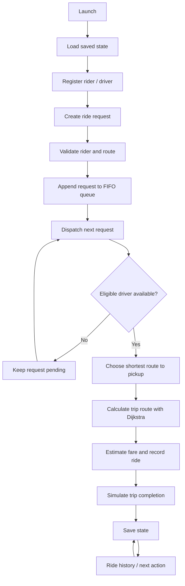

<div align="center">

# 🏍️ Smart Bike Taxi Platform

**A modular C++17 ride-booking simulation built around data structures and algorithms.**

Shortest-path routing · FIFO ride requests · Nearest-driver dispatch · Local persistence


</div>

---


## Full-stack roadmap status

This repository is being extended from its original C++17 academic simulation into **Saarthi**, an original bike-taxi booking product. The C++ API now exposes PostgreSQL-backed quotes, passenger authentication and persisted booking, cancellation, history, driver lifecycle, and admin metrics endpoints. This is still an incremental portfolio build—not a live commercial ride service.

| Area | Current evidence | Status |
|---|---|---|
| C++ DSA baseline | Existing C++ build/tests and GCC/Clang/sanitizer CI | Existing baseline |
| Route algorithm | Deterministic equal-distance predecessor selection, zero-weight parent-cycle guard, and overflow handling; disconnected/extreme-weight tests | GCC, Clang and ASan/UBSan passed on current feature head `b602515d6c7815126b34f4a0340e38e4c800d9d0` |
| Ride lifecycle/dispatch | Cancellation releases drivers; tests cover cancellation/reassignment, deterministic driver ties and unreachable drivers | GCC, Clang and ASan/UBSan passed on current feature head |
| Benchmarking | Deterministic 1,000-node / 1,000-query benchmark, CI CSV artifact, checked-in sample with environment notes | A real CI sample is recorded in [`benchmarks/results/ubuntu-latest-2026-10-18.csv`](benchmarks/results/ubuntu-latest-2026-10-18.csv); one run is not a general performance claim |
| Web UI | React + TypeScript + Vite; lazy-loaded Leaflet map; Nominatim geocoding + OSRM road geometry; pickup/drop autocomplete; quote expiry validation | CI covers typecheck/build, high-severity npm audit, gzip budgets, desktop/mobile Playwright E2E and axe accessibility audit; dependency installation is lockfile-backed with `npm ci` |
| API service | C++17 Boost.Beast HTTP server; health, quote, passenger auth/booking/history/cancellation, driver queue/accept/status/availability, and admin metrics routes | CI builds with warnings as errors and smoke-tests API/database behavior, including request size limits and booking validation; public routing providers are not exercised by CI |
| PostgreSQL | Initial schema includes accounts, driver profiles, rides, route quotes, event history, idempotency and active-driver uniqueness guard | CI applies migration to PostgreSQL 16; no production DB or migration runner configured |
| Authentication and passenger booking | PBKDF2 password hashing, short-lived signed access tokens, role/ownership checks, quote consumption, transactional idempotency, ride history and cancellation | API implemented with smoke coverage; expand authorization and concurrency tests before release |
| Driver/admin operations | Driver queue/accept/state/availability and protected admin metrics API | Backend routes and connected driver/admin web workspaces implemented; trusted driver provisioning and end-to-end role/concurrency verification remain blockers |
| Realtime, payments and safety operations | Not implemented | Release blockers; do not claim these are live |
| Reproducible installs | `web/package-lock.json` not yet generated; CI still uses `npm install` | Release blocker; generate a genuine lockfile in a network-enabled checkout and switch to `npm ci` |
| Deployment and screenshots | No live full-stack deployment verified | Planned |

### Frontend development

```bash
cd web
npm install
npm run dev
npm run typecheck
npm run build
```

The web CI workflow runs typechecking and a production build. The web interface requests real road geometry through configurable geocoding/routing adapters and an interactive OpenStreetMap view. The API calculates and persists a five-minute demo quote in PostgreSQL; the UI supports passenger registration/sign-in, ride confirmation, and cancellation through API calls. Playwright desktop/mobile E2E, axe accessibility audit, high-severity npm audit and gzip budgets run in CI. Public demo routing endpoints are for evaluation only. Drivers can manually accept requests in the driver workspace and passenger ride state polls while the page is visible; automated dispatch, live GPS tracking, and push notifications are not implemented. Lockfile-backed installs now use the committed `web/package-lock.json` and `npm ci`; deployment verification remains tracked in [issue #3](https://github.com/kaustubhdua/Smart_bike_taxi_platform/issues/3).

### C++ tests and benchmark

```bash
cmake -S . -B build -DCMAKE_BUILD_TYPE=Debug
cmake --build build --parallel
ctest --test-dir build --output-on-failure

cmake -S . -B build-bench -DSMART_BIKE_TAXI_BUILD_BENCHMARKS=ON -DCMAKE_BUILD_TYPE=Release
cmake --build build-bench --target smart_bike_taxi_benchmark --parallel
./build-bench/smart_bike_taxi_benchmark 1000 1000
```

The benchmark prints CSV timing data for route queries and custom-versus-standard hash lookup. Results are hardware/compiler/dataset dependent; do not claim one structure is faster until results are recorded under a reproducible environment.

### Backend contract and schema

See [backend/README.md](backend/README.md), [OpenAPI contract](backend/openapi.yaml) and [initial PostgreSQL migration](backend/migrations/001_initial_schema.sql). The native service supports database-backed quotes, passenger registration/login, signed access tokens, idempotent booking transactions, ride history/detail reads, cancellation, driver queue/availability/acceptance/lifecycle-transition endpoints and admin metrics. Backend CI covers API compilation, auth/booking smoke behavior, and clean PostgreSQL migrations. Trusted driver onboarding, broader concurrency/authorization tests, push-based real-time delivery, and production deployment remain release gates. Track the remaining work in [issue #2](https://github.com/kaustubhdua/Smart_bike_taxi_platform/issues/2).

### Run the API and PostgreSQL locally

With Docker Compose installed, copy `.env.example` to `.env`, replace the local database password in both `POSTGRES_PASSWORD` and `DATABASE_URL`, set a contact-bearing `SAARTHI_USER_AGENT`, and generate a random `SAARTHI_JWT_SECRET` of at least 32 characters. Optional provider URL overrides are documented in the template. Then run:

```bash
docker compose up --build
curl http://localhost:8080/api/v1/health
```

Compose applies the initial schema to the local PostgreSQL volume before starting the API. Use a strong local password and do not reuse development values in a public deployment. The quote endpoint depends on public Nominatim/OSRM demo services; configure a real provider/contact identifier before use and do not treat these endpoints as production infrastructure.

### UI libraries and attribution

The design is original and may incorporate licensed open-source components selectively. Review each upstream package's license and retain its notices before copying or vendoring code. Reference libraries include [React Bits](https://github.com/DavidHDev/react-bits), [Magic UI](https://github.com/magicuidesign/magicui), [Radix UI](https://www.radix-ui.com/), [Motion](https://motion.dev/) and [Lucide](https://lucide.dev/). No third-party proprietary ride-hailing source or branding is copied.

## Overview

Smart Bike Taxi Platform is an interactive terminal application that demonstrates how core DSA concepts can support a simplified ride-hailing workflow. It uses a small, illustrative Noida road network and lets users register riders and drivers, request and cancel rides, dispatch requests, estimate fares, and review ride history.

> The C++ console application is an academic simulation. The separate web UI can request road geometry and persist passenger ride requests through the API. Live automated dispatch, driver tracking, payments, and safety operations are not available.

## Workflow



## Features

| Feature | Description |
| --- | --- |
| Road network | Weighted, undirected graph with sample Noida locations |
| Route planning | Dijkstra shortest path with route reconstruction |
| Rider and driver records | Custom linear-probing hash table |
| Request management | FIFO queue, pending count, and cancellation by request ID |
| Driver matching | Min-priority queue selects the available driver with the shortest route to pickup |
| Driver controls | List drivers and toggle availability |
| Ride lifecycle | Assigned → in progress → completed; driver is released only on completion |
| Fare estimate | Sample formula: ₹20 base + ₹10 per km |
| Ride history | Lists all recorded rides and their current status |
| Persistence | Saves riders, drivers, pending requests, history, and ID counters to a local file |
| Automated checks | GitHub Actions compiles the app and tests with warnings treated as errors |

## DSA concepts

| Use case | Implementation | Complexity |
| --- | --- | --- |
| Road network | Adjacency list | O(V + E) space |
| Shortest path | Dijkstra with binary heap | O((V + E) log V) |
| Record lookup | Linear-probing hash table | Average O(1), worst O(n) |
| Request order | FIFO queue | O(1) enqueue/dequeue |
| Driver candidate selection | Min-heap | O(log D) per insertion/removal |

V = locations, E = roads, D = eligible drivers. Hash table performance depends on load factor and collisions.

## Project structure

```text
.
├── .github/workflows/cpp.yml  # GCC, Clang, and sanitizer CI
├── CMakeLists.txt             # Portable build and CTest configuration
├── graph/Graph.h              # Graph and Dijkstra
├── models/Models.h            # Rider, driver, request, ride models
├── storage/Storage.h          # Versioned local save/load
├── structures/HashTable.h     # Linear-probing hash table
├── main.cpp                   # Interactive application
├── tests.cpp                  # Unit and persistence tests
└── README.md
```

## Requirements

- C++17-compatible compiler (g++ recommended)
- Terminal / PowerShell

## Build and run

Run from the repository root. CMake is the recommended cross-platform build path.

**CMake (Windows, Linux, macOS)**

```bash
cmake -S . -B build
cmake --build build --parallel
```

Run the generated `smart_bike_taxi` (or `smart_bike_taxi.exe` on Windows) from the build directory. The application stores its data in the current working directory.

**Windows (MinGW / PowerShell, direct compiler)**

```powershell
g++ -std=c++17 -Wall -Wextra -Wpedantic main.cpp -o smart_bike_taxi.exe
.\smart_bike_taxi.exe
```

**Linux / macOS (direct compiler)**

```bash
g++ -std=c++17 -Wall -Wextra -Wpedantic main.cpp -o smart_bike_taxi
./smart_bike_taxi
```

### Menu

| Option | Action |
| ---: | --- |
| 1 | Show locations |
| 2 | Register rider |
| 3 | Register driver |
| 4 | Request a ride |
| 5 | Dispatch next request |
| 6 | Show ride history |
| 7 | Show pending request count |
| 8 | Cancel a pending request |
| 9 | Show drivers |
| 10 | Toggle driver availability |
| 11 | Start an assigned ride |
| 12 | Complete an in-progress ride |
| 0 | Exit |

Enter location names exactly as listed by **Show locations**.

## Run tests

**Windows**

```powershell
g++ -std=c++17 -Wall -Wextra -Wpedantic tests.cpp -o tests.exe
.\tests.exe
```

**Linux / macOS**

```bash
g++ -std=c++17 -Wall -Wextra -Wpedantic tests.cpp -o tests
./tests
```

Tests cover graph and hash-table behavior, invalid road weights, persistence save/load, malformed-file rejection without partial mutation, driver dispatch selection, ride lifecycle transitions, and rejection of zero-length ride requests. GitHub Actions builds with GCC and Clang and runs the tests; a separate job enables AddressSanitizer and UndefinedBehaviorSanitizer. Run locally with `cmake -S . -B build`, `cmake --build build --parallel`, then `ctest --test-dir build --output-on-failure`.

## Local data

The application writes `smart_bike_taxi_data.txt` in the current working directory and saves after each menu action. Keep this file in the same directory when restarting the application to restore the demo state.

- The file is local, plain-text demo storage—not encrypted or suitable for sensitive personal information.
- Do not enter real phone numbers or other private information.
- The file is excluded from Git by `.gitignore`.
- The save format is versioned; incompatible or malformed data causes startup to stop with an error rather than silently overwrite it.

## Sample map and fare

The built-in map includes JIIT 128, Sector 62, Botanical Garden, Noida City Centre, and Sector 18. Distances are illustrative values defined in the source, not official road distances.

Fare estimate = ₹20 + (shortest trip distance in km × ₹10). This is a demonstration formula, not a real-world fare quote.

## Limitations

- Dispatch, ride start, and trip completion are synchronous simulations; the operator manually advances ride states.
- No live GPS, map provider, traffic data, OTP, authentication, database server, payment gateway, or buyer/operator network is connected.
- The local data file is intended for a single-user demo and has no concurrent-write protection.
- The custom hash table has a fixed capacity of 101 records per table; when full, new records are rejected.
- Saves write a temporary snapshot and retain the previous snapshot as a backup during replacement; sudden power loss and filesystem-specific rename behavior can still affect recovery.

## Further development

Possible extensions include a configurable map, a larger/resizing hash table, broader dispatch/cancellation integration tests, cancellation of already-assigned rides, and a real backend. Production use would also require authentication, privacy controls, secure storage, operational monitoring, and real service integrations.

---

<div align="center">

Built as a C++17 DSA academic project.

**[View repository](https://github.com/kaustubhdua/Smart_bike_taxi_platform)**

</div>
