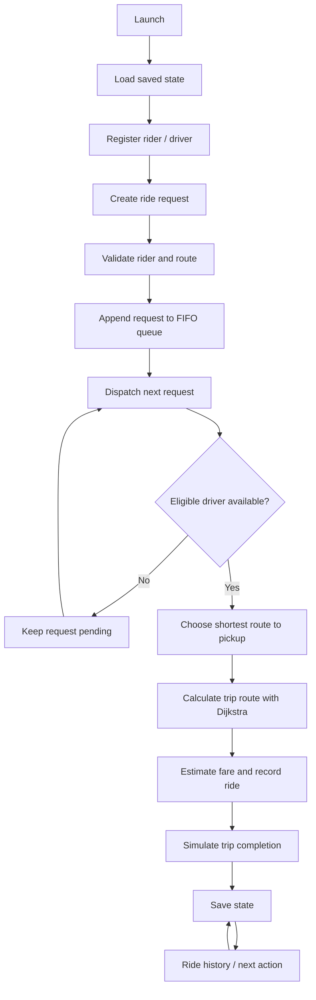

<div align="center">

# 🏍️ RideForge — Smart Bike Taxi Platform

**A C++17-powered bike-taxi platform with a real API, PostgreSQL bookings, and driver/admin workspaces.**

Shortest-path routing · FIFO ride requests · Nearest-driver dispatch · Local persistence


</div>

---


## Run the complete verification suite

The [Full release readiness workflow](https://github.com/kaustubhdua/Smart_bike_taxi_platform/actions/workflows/release-readiness.yml) runs the C++/sanitizer/benchmark, API integration, PostgreSQL migration and backup/restore, web/Playwright/accessibility, and container/Compose suites against the selected branch commit. Use **Run workflow** on the feature branch before asking for review; record the exact tested SHA. PR #4 is the active release candidate. Treat the latest head SHA and its GitHub Actions checks as the source of truth; do not merge unless all eight CI/security suites pass on the same current SHA.

## Full-stack roadmap status

For a complete local passenger → driver → admin walkthrough, see [docs/DEMO_WALKTHROUGH.md](docs/DEMO_WALKTHROUGH.md). The walkthrough uses demo fares and local/test accounts; it does not represent a commercial service.

See [`docs/DEEP_IMPROVEMENT_RESEARCH.md`](docs/DEEP_IMPROVEMENT_RESEARCH.md) for the research-backed priority order, security/reliability recommendations, acceptance criteria, and release gates. The implementation status below is not a production-readiness claim.

This repository is being extended from its original C++17 academic simulation into **RideForge**, an original bike-taxi booking product. The C++ API now exposes PostgreSQL-backed quotes, passenger authentication and persisted booking, cancellation, history, driver lifecycle, audited admin driver provisioning/approval/suspension, and admin metrics and persisted support/incident-report endpoints with admin review/resolution. This is still an incremental portfolio build—not a live commercial ride service.

| Area | Current evidence | Status |
|---|---|---|
| C++ DSA baseline | Existing C++ build/tests and GCC/Clang/sanitizer CI | Existing baseline |
| Route algorithm | Deterministic equal-distance predecessor selection, zero-weight parent-cycle guard, and overflow handling; disconnected/extreme-weight tests | GCC, Clang and ASan/UBSan run on the current PR head; check PR #4 for the latest result |
| Ride lifecycle/dispatch | Cancellation releases drivers; tests cover cancellation/reassignment, deterministic driver ties and unreachable drivers | GCC, Clang and ASan/UBSan are required on every release-candidate head; check PR #4 for the latest result |
| Benchmarking | Deterministic 1,000-node / 1,000-query benchmark; CI publishes a CSV artifact with environment notes | A sample is checked into [`benchmarks/results/ubuntu-latest-2026-10-18.csv`](benchmarks/results/ubuntu-latest-2026-10-18.csv), and CI publishes fresh CSV artifacts; one run is not a general performance claim |
| Web UI | React + TypeScript + Vite; lazy-loaded Leaflet map; Nominatim geocoding + OSRM road geometry; pickup/drop autocomplete and map-click selection; quote expiry validation | CI covers typecheck/build, high-severity npm audit, gzip budgets, desktop/mobile Playwright E2E and axe accessibility audit; dependency installation is lockfile-backed with `npm ci` |
| API service | C++17 Boost.Beast HTTP server; database liveness and schema readiness probes, quote, passenger auth/booking/history/cancellation, driver queue/accept/status/availability, admin driver provisioning/approval/suspension, and metrics routes | CI builds with warnings as errors and smoke-tests API/database behavior, including request size limits and booking validation; public routing providers are not exercised by CI |
| PostgreSQL | Versioned migrations include accounts, driver profiles, rides, quotes, idempotency, active-driver uniqueness, explicit driver approval, admin audit events and a transactional ride-event outbox | CI is configured to apply all migrations twice and check schema/outbox invariants; no production database is configured |
| Authentication and passenger booking | PBKDF2 password hashing, short-lived signed access tokens, role/ownership checks, quote consumption, transactional idempotency, ride history and cancellation | API implemented with smoke coverage; expand authorization and concurrency tests before release |
| Driver/admin operations | Driver queue is restricted to approved online drivers with a fresh location and configurable pickup radius (20 km default); acceptance rechecks approval, freshness and distance transactionally; admin can provision/approve/suspend, review audit history, and actions are audited | Connected driver/admin workspaces and API smoke coverage; real identity/vehicle verification remains out of scope |
| Realtime, payments and safety operations | Durable outbox worker publishes through PostgreSQL NOTIFY with retry/dead-letter handling; API exposes authenticated SSE with persisted-event replay and the passenger UI consumes ride-status frames | SSE fallback/resync needs broader load/reconnect verification; payments and safety operations remain release blockers |
| Reproducible installs | `web/package-lock.json` is committed and web CI uses `npm ci` | CI validates lockfile-backed installation on the PR head; check the latest result before release |
| Deployment and screenshots | No live full-stack deployment verified | Planned |

### CI and release evidence

PR #4 runs the eight release suites: C++ builds/tests/sanitizers/benchmark, API and HTTP integration, PostgreSQL migrations/invariants/restore, web typecheck/build/Playwright/axe, Compose startup, dependency audit, CodeQL, and container vulnerability scanning. Use the latest [PR #4 checks](https://github.com/kaustubhdua/Smart_bike_taxi_platform/pull/4) and verify they all pass on the same head SHA. Historical green runs do not validate later commits.

The API integration suite validates the configurable dispatch radius using a non-default value and confirms invalid radius configuration fails before the listener starts. A live full-stack deployment, genuine deployed screenshots, manual accessibility review, and production operational/legal gates remain open.
## Original C++17 terminal simulation (DSA lab)

Smart Bike Taxi Platform is an interactive terminal application that demonstrates how core DSA concepts can support a simplified ride-hailing workflow. It uses a small, illustrative Noida road network and lets users register riders and drivers, request and cancel rides, dispatch requests, estimate fares, and review ride history.

> The C++ console application is an academic simulation. The separate web/API stack supports persisted passenger bookings, protected driver acceptance/lifecycle operations, browser-geolocation-based driver availability, and admin driver approval. Live ride-status events and an active-trip driver-location marker are supported; real payments, verified driver identity, and real safety operations are not available.

### Workflow



### Features

| Feature | Description |
| --- | --- |
| Road network | Weighted, undirected graph with sample Noida locations |
| Route planning | Dijkstra shortest path with route reconstruction |
| Rider and driver records | Custom linear-probing hash table |
| Request management | FIFO queue, pending count, and cancellation by request ID |
| Driver matching | Min-priority queue selects the available driver with the shortest route to pickup |
| Driver controls | List drivers and toggle availability |
| Ride lifecycle | Assigned → in progress → completed; driver is released only on completion |
| Fare estimate | Sample formula: ₹20 base + ₹10 per km |
| Ride history | Lists all recorded rides and their current status |
| Persistence | Saves riders, drivers, pending requests, history, and ID counters to a local file |
| Automated checks | GitHub Actions compiles the app and tests with warnings treated as errors |

### DSA concepts

| Use case | Implementation | Complexity |
| --- | --- | --- |
| Road network | Adjacency list | O(V + E) space |
| Shortest path | Dijkstra with binary heap | O((V + E) log V) |
| Record lookup | Linear-probing hash table | Average O(1), worst O(n) |
| Request order | FIFO queue | O(1) enqueue/dequeue |
| Driver candidate selection | Min-heap | O(log D) per insertion/removal |

V = locations, E = roads, D = eligible drivers. Hash table performance depends on load factor and collisions.

### Project structure

```text
.
├── .github/workflows/cpp.yml  # GCC, Clang, and sanitizer CI
├── CMakeLists.txt             # Portable build and CTest configuration
├── graph/Graph.h              # Graph and Dijkstra
├── models/Models.h            # Rider, driver, request, ride models
├── storage/Storage.h          # Versioned local save/load
├── structures/HashTable.h     # Linear-probing hash table
├── main.cpp                   # Interactive application
├── tests.cpp                  # Unit and persistence tests
└── README.md
```

### Requirements

- C++17-compatible compiler (g++ recommended)
- Terminal / PowerShell

### Build and run

Run from the repository root. CMake is the recommended cross-platform build path.

**CMake (Windows, Linux, macOS)**

```bash
cmake -S . -B build
cmake --build build --parallel
```

Run the generated `smart_bike_taxi` (or `smart_bike_taxi.exe` on Windows) from the build directory. The application stores its data in the current working directory.

**Windows (MinGW / PowerShell, direct compiler)**

```powershell
g++ -std=c++17 -Wall -Wextra -Wpedantic main.cpp -o smart_bike_taxi.exe
.\smart_bike_taxi.exe
```

**Linux / macOS (direct compiler)**

```bash
g++ -std=c++17 -Wall -Wextra -Wpedantic main.cpp -o smart_bike_taxi
./smart_bike_taxi
```

### Menu

| Option | Action |
| ---: | --- |
| 1 | Show locations |
| 2 | Register rider |
| 3 | Register driver |
| 4 | Request a ride |
| 5 | Dispatch next request |
| 6 | Show ride history |
| 7 | Show pending request count |
| 8 | Cancel a pending request |
| 9 | Show drivers |
| 10 | Toggle driver availability |
| 11 | Start an assigned ride |
| 12 | Complete an in-progress ride |
| 0 | Exit |

Enter location names exactly as listed by **Show locations**.

### Run tests

**Windows**

```powershell
g++ -std=c++17 -Wall -Wextra -Wpedantic tests.cpp -o tests.exe
.\tests.exe
```

**Linux / macOS**

```bash
g++ -std=c++17 -Wall -Wextra -Wpedantic tests.cpp -o tests
./tests
```

Tests cover graph and hash-table behavior, invalid road weights, persistence save/load, malformed-file rejection without partial mutation, driver dispatch selection, ride lifecycle transitions, and rejection of zero-length ride requests. GitHub Actions builds with GCC and Clang and runs the tests; a separate job enables AddressSanitizer and UndefinedBehaviorSanitizer. Run locally with `cmake -S . -B build`, `cmake --build build --parallel`, then `ctest --test-dir build --output-on-failure`.

### Local data

The application writes `smart_bike_taxi_data.txt` in the current working directory and saves after each menu action. Keep this file in the same directory when restarting the application to restore the demo state.

- The file is local, plain-text demo storage—not encrypted or suitable for sensitive personal information.
- Do not enter real phone numbers or other private information.
- The file is excluded from Git by `.gitignore`.
- The save format is versioned; incompatible or malformed data causes startup to stop with an error rather than silently overwrite it.

### Sample map and fare

The built-in map includes JIIT 128, Sector 62, Botanical Garden, Noida City Centre, and Sector 18. Distances are illustrative values defined in the source, not official road distances.

Fare estimate = ₹20 + (shortest trip distance in km × ₹10). This is a demonstration formula, not a real-world fare quote.

### Limitations of the terminal simulation

- Dispatch, ride start, and trip completion are synchronous simulations; the operator manually advances ride states.
- No live GPS, map provider, traffic data, OTP, authentication, database server, payment gateway, or buyer/operator network is connected.
- The local data file is intended for a single-user demo and has no concurrent-write protection.
- The custom hash table has a fixed capacity of 101 records per table; when full, new records are rejected.
- Saves write a temporary snapshot and retain the previous snapshot as a backup during replacement; sudden power loss and filesystem-specific rename behavior can still affect recovery.

### Further development of the terminal simulation

The terminal simulator remains a deliberately small, local-only DSA exercise. Possible improvements to that component include a configurable sample graph, a resizing hash table, and additional algorithm edge-case tests. For the separate full-stack product, use the RideForge roadmap and release gates above; do not infer production readiness from the terminal simulator.

---

<div align="center">

RideForge full-stack portfolio MVP · C++17 DSA simulator

**[View repository](https://github.com/kaustubhdua/Smart_bike_taxi_platform)**

</div>


