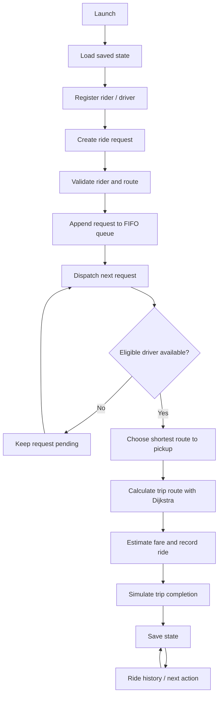

<div align="center">

# 🏍️ RideForge — Smart Bike Taxi Platform

**A C++17 DSA simulator with a Supabase-backed bike-taxi web platform, transactional bookings, and driver/admin workspaces.**

Shortest-path routing · Durable 45-second driver offers · Automatic expiry/redispatch · Transactional bookings


</div>

---

## Run the complete verification suite

The [Full release readiness workflow](https://github.com/kaustubhdua/Smart_bike_taxi_platform/actions/workflows/release-readiness.yml) aggregates the C++/sanitizer/benchmark, API integration, PostgreSQL migration and recovery, web/Playwright/accessibility, and container/Compose suites. Durable driver offers and expiry/redispatch were merged in PR [#13](https://github.com/kaustubhdua/Smart_bike_taxi_platform/pull/13). The bounded dispatch-attempt exhaustion fix was merged in PR [#15](https://github.com/kaustubhdua/Smart_bike_taxi_platform/pull/15), after the full release-readiness workflow passed all 13 jobs on tested PR head `ec8780b20beef1470047f23f73f9705ac148f5a6`. See [the exact full-suite run](https://github.com/kaustubhdua/Smart_bike_taxi_platform/actions/runs/40571466789) and [API smoke run](https://github.com/kaustubhdua/Smart_bike_taxi_platform/actions/runs/40571466885). These results validate that tested revision, not a live deployment or production operations. The production-readiness evidence and release gates are documented in [`docs/RELEASE_READINESS_EVIDENCE.md`](docs/RELEASE_READINESS_EVIDENCE.md). Always verify fresh workflow runs on the exact release SHA before publishing.

## Full-stack roadmap status

See [`docs/ARCHITECTURE.md`](docs/ARCHITECTURE.md) for the source-of-truth architecture, [`docs/COMPLETION_MATRIX.md`](docs/COMPLETION_MATRIX.md) for the 100-point evidence register, and [`docs/DEEP_IMPROVEMENT_RESEARCH.md`](docs/DEEP_IMPROVEMENT_RESEARCH.md) for the research-backed priority order, security/reliability recommendations, acceptance criteria, and release gates. The implementation status below is not a production-readiness claim.

This repository has evolved from its original C++17 academic simulation into **RideForge**, an original bike-taxi portfolio MVP. The web platform now targets a Supabase-native backend: Supabase Auth, PostgreSQL, Edge Functions, transactional RPCs, RLS and Realtime. The migration is tracked in PR [#79](https://github.com/kaustubhdua/Smart_bike_taxi_platform/pull/79); the Edge Function and additive database migrations are already deployed. The static evaluation frontend remains hosted at [rideforge-web.onrender.com](https://rideforge-web.onrender.com). See [the Supabase backend runbook](docs/SUPABASE_BACKEND.md) for the migration architecture, administrator bootstrap and deployment details. The legacy C++ API is retained in the repository during the cutover window; it is no longer the intended application backend. RideForge is a portfolio demo, not a live taxi service: no real passenger transport, payments, verified driver/vehicle onboarding or emergency dispatch are offered. Use public landmarks/test locations only; do not submit home addresses or personal data to the public OpenStreetMap demo providers.

| Area | Current evidence | Status |
|---|---|---|
| C++ DSA baseline | Existing C++ build/tests and GCC/Clang/sanitizer CI | Existing baseline |
| Route algorithm | Deterministic equal-distance predecessor selection, zero-weight parent-cycle guard, and overflow handling; disconnected/extreme-weight tests | GCC, Clang and ASan/UBSan are required CI checks; see the live PR checks for the exact tested head |
| Ride lifecycle/dispatch | Cancellation releases drivers; tests cover cancellation/reassignment, deterministic driver ties and unreachable drivers | GCC, Clang and ASan/UBSan passed on release-branch SHA `de6884ea7b46140509cd39bfd785e3c52f7c1bdb` |
| Benchmarking | Deterministic 1,000-node / 1,000-query benchmark; CI publishes a CSV artifact with environment notes | Download the artifact from the [C++ workflow runs](https://github.com/kaustubhdua/Smart_bike_taxi_platform/actions/workflows/cpp.yml); no benchmark sample is currently checked into this branch, and one run is not a general performance claim |

| Authentication and passenger booking | Supabase Auth, account-sync trigger, verified-email signup path, service-role-only booking RPC, quote consumption, transactional idempotency, ride history and cancellation | Supabase backend deployed; auth browser E2E and first-admin bootstrap remain release gates |
| Driver/admin operations | Supabase Edge routes and transactional RPCs enforce driver approval, location freshness, 45-second offers, five distinct dispatch attempts, ride transitions and admin audit | Database transaction tests pass; full browser E2E and first-admin bootstrap remain open |
| Realtime, payments and safety operations | Supabase Realtime publication, participant-scoped RLS and authenticated SSE compatibility endpoint backed by persisted ride events | State-change SQL tests pass; reconnect/load tests, payments and real safety operations remain release blockers |
| Reproducible installs | `web/package-lock.json` is committed and web CI uses `npm ci` | CI validates lockfile-backed installation; current-head checks are required after any subsequent changes |
| Deployment and screenshots | React static site remains on Render; API points to deployed Supabase Edge Function `rideforge-api` | Static-site env deploy is live; Render API service retirement and full end-to-end smoke verification remain open |

### Frontend development

```bash
cd web
npm install
cp .env.example .env   # sets VITE_API_BASE_URL=http://localhost:8080; without it the UI cannot reach the API
npm run dev
npm run typecheck
npm run build
```

Start the API first (see [Run the API and PostgreSQL locally](#run-the-api-and-postgresql-locally)); the web app only talks to it, it does not start it.

The web CI workflow runs typechecking and a production build. The React client talks to the Supabase Edge Function; it does not connect directly to PostgreSQL with privileged credentials. The Edge Function calculates and persists five-minute road-route quotes, while PostgreSQL RPCs own idempotent booking, exclusive driver offers, acceptance and ride-state transitions. Passenger and driver workspaces retain the existing booking, cancellation, history, support and operations flows. Ride status is persisted in `ride_events` and streamed through an authenticated SSE compatibility endpoint, with Supabase Realtime publication available for participant-authorized subscriptions. Driver location is exposed only while fresh and during an eligible ride; no historical GPS trail is published. The legacy C++ API, outbox worker and Compose deployment remain in the repository for rollback/reference until the Render service retirement is completed. Push notifications, payments, verified identity/vehicle onboarding and emergency response remain out of scope.

**Fare-model distinction:** the original terminal DSA simulator retains its illustrative ₹20 + ₹10/km formula. The newer PostgreSQL-backed RideForge API uses a separate ₹20 base + ₹11/km demo tariff, returns base and distance components in integer paise, and persists the total quote. Neither formula is a commercial fare or a promise of a real-world price.

### C++ tests and benchmark

```bash
cmake -S . -B build -DCMAKE_BUILD_TYPE=Debug
cmake --build build --parallel
ctest --test-dir build --output-on-failure

cmake -S . -B build-bench -DSMART_BIKE_TAXI_BUILD_BENCHMARKS=ON -DCMAKE_BUILD_TYPE=Release
cmake --build build-bench --target smart_bike_taxi_benchmark --parallel
./build-bench/smart_bike_taxi_benchmark 1000 1000
```

The benchmark prints CSV timing data for route queries and custom-versus-standard hash lookup. Results are hardware/compiler/dataset dependent; do not claim one structure is faster until results are recorded under a reproducible environment.

### Backend contract and schema


Security automation includes scheduled CodeQL analysis for C++/TypeScript and dependency-review checks for high-severity or disallowed-license changes; those checks must pass on the release SHA before merge. The API also emits redacted JSON request-completion logs and provides a schema-aware readiness endpoint.

See also the [implementation roadmap](docs/IMPLEMENTATION_ROADMAP.md), [security model and release checklist](docs/SECURITY_MODEL.md), and [operations runbook](docs/OPERATIONS_RUNBOOK.md). These documents separate implemented behavior from release blockers and do not claim commercial readiness.

### Run the API and PostgreSQL locally

With Docker Compose installed, copy `.env.example` to `.env`, set separate owner and runtime passwords in `POSTGRES_PASSWORD` and `RIDEFORGE_APP_PASSWORD`, and use the runtime password in `DATABASE_URL`, set a contact-bearing `RIDEFORGE_USER_AGENT`, and generate a random `RIDEFORGE_JWT_SECRET` of at least 32 characters. Optional provider URL overrides are documented in the template. Then run:

```bash
docker compose up --build
curl http://localhost:8080/api/v1/health
curl --fail http://localhost:8080/api/v1/ready
```


### Container deployment

See [the local deployment guide](docs/local-deployment.md) for the development Compose stack and [the production deployment template](docs/production-deployment.md) for a two-host HTTPS setup using separate passenger and driver domains, exact CORS origin allowlisting, same-origin API proxying, loopback-only app ports, and persistent PostgreSQL storage. The protected admin sign-in is available at `/admin` on the passenger host. The production template is not a live deployment; a domain, VPS, secret generation, and provider agreement are still required.

### UI libraries and attribution

The design is original and may incorporate licensed open-source components selectively. Review each upstream package's license and retain its notices before copying or vendoring code. Reference libraries include [React Bits](https://github.com/DavidHDev/react-bits), [Magic UI](https://github.com/magicuidesign/magicui), [Radix UI](https://www.radix-ui.com/), [Motion](https://motion.dev/) and [Lucide](https://lucide.dev/). No third-party proprietary ride-hailing source or branding is copied.

## Original C++17 terminal simulation (legacy DSA component)

The following sections document the original academic command-line simulation. Its local-file persistence and synchronous/manual workflows are separate from the RideForge full-stack API, PostgreSQL database, and web application described above.

Smart Bike Taxi Platform is an interactive terminal application that demonstrates how core DSA concepts can support a simplified ride-hailing workflow. It uses a small, illustrative Noida road network and lets users register riders and drivers, request and cancel rides, dispatch requests, estimate fares, and review ride history.

> The C++ console application is an academic simulation. The separate web/API stack supports persisted passenger bookings, protected driver acceptance/lifecycle operations, browser-geolocation-based driver availability, and admin driver approval. Live ride-status events and an active-trip driver-location marker are supported; real payments, verified driver identity, and real safety operations are not available.

## Workflow



## Features

| Feature | Description |
| --- | --- |
| Road network | Weighted, undirected graph with sample Noida locations |
| Route planning | Dijkstra shortest path with route reconstruction |
| Rider and driver records | Custom linear-probing hash table |
| Request management | FIFO queue, pending count, and cancellation by request ID |
| Driver matching | Min-priority queue selects the available driver with the shortest route to pickup |
| Driver controls | List drivers and toggle availability |
| Ride lifecycle | Assigned → in progress → completed; driver is released only on completion |
| Fare estimate | Legacy terminal simulator: ₹20 base + ₹10/km. API portfolio quote: ₹20 base + ₹11/km, returned as a transparent integer-paise breakdown. |
| Ride history | Lists all recorded rides and their current status |
| Persistence | Saves riders, drivers, pending requests, history, and ID counters to a local file |
| Automated checks | GitHub Actions compiles the app and tests with warnings treated as errors |

## DSA concepts

| Use case | Implementation | Complexity |
| --- | --- | --- |
| Road network | Adjacency list | O(V + E) space |
| Shortest path | Dijkstra with binary heap | O((V + E) log V) |
| Record lookup | Linear-probing hash table | Average O(1), worst O(n) |
| Request order | FIFO queue | O(1) enqueue/dequeue |
| Driver candidate selection | Min-heap | O(log D) per insertion/removal |

V = locations, E = roads, D = eligible drivers. Hash table performance depends on load factor and collisions.

## Project structure

```text
.
├── .github/workflows/cpp.yml  # GCC, Clang, and sanitizer CI
├── CMakeLists.txt             # Portable build and CTest configuration
├── graph/Graph.h              # Graph and Dijkstra
├── models/Models.h             # Rider, driver, request, ride models
├── storage/Storage.h           # Versioned local save/load
├── structures/HashTable.h     # Linear-probing hash table
├── main.cpp                   # Interactive application
├── tests.cpp                  # Unit and persistence tests
└── README.md
```

## Requirements

- C++17-compatible compiler (g++ recommended)
- Terminal / PowerShell

## Build and run

Run from the repository root. CMake is the recommended cross-platform build path.

**CMake (Windows, Linux, macOS)**

```bash
cmake -S . -B build
cmake --build build --parallel
```

Run the generated `smart_bike_taxi` (or `smart_bike_taxi.exe` on Windows) from the build directory. The application stores its data in the current working directory.

**Windows (MinGW / PowerShell, direct compiler)**

```powershell
g++ -std=c++17 -Wall -Wextra -Wpedantic main.cpp -o smart_bike_taxi.exe
.\\smart_bike_taxi.exe
```

**Linux / macOS (direct compiler)**

```bash
g++ -std=c++17 -Wall -Wextra -Wpedantic main.cpp -o smart_bike_taxi
./smart_bike_taxi
```

### Menu

| Option | Action |
| ---: | --- |
| 1 | Show locations |
| 2 | Register rider |
| 3 | Register driver |
| 4 | Request a ride |
| 5 | Dispatch next request |
| 6 | Show ride history |
| 7 | Show pending request count |
| 8 | Cancel a pending request |
| 9 | Show drivers |
| 10 | Toggle driver availability |
| 11 | Start an assigned ride |
| 12 | Complete an in-progress ride |
| 0 | Exit |

Enter location names exactly as listed by **Show locations**.

## Run tests

**Windows**

```powershell
g++ -std=c++17 -Wall -Wextra -Wpedantic tests.cpp -o tests.exe
.\\tests.exe
```

**Linux / macOS**

```bash
g++ -std=c++17 -Wall -Wextra -Wpedantic tests.cpp -o tests
./tests
```

Tests cover graph and hash-table behavior, invalid road weights, persistence save/load, malformed-file rejection without partial mutation, driver dispatch selection, ride lifecycle transitions, and rejection of zero-length ride requests. GitHub Actions builds with GCC and Clang and runs the tests; a separate job enables AddressSanitizer and UndefinedBehaviorSanitizer. Run locally with `cmake -S . -B build`, `cmake --build build --parallel`, then `ctest --test-dir build --output-on-failure`.

## Local data

The application writes `smart_bike_taxi_data.txt` in the current working directory and saves after each menu action. Keep this file in the same directory when restarting the application to restore the demo state.

- The file is local, plain-text demo storage—not encrypted or suitable for sensitive personal information.
- Do not enter real phone numbers or other private information.
- The file is excluded from Git by `.gitignore`.
- The save format is versioned; incompatible or malformed data causes startup to stop with an error rather than silently overwrite it.

## Sample map and fare

The built-in map includes JIIT 128, Sector 62, Botanical Garden, Noida City Centre, and Sector 18. Distances are illustrative values defined in the source, not official road distances.

Fare estimate = ₹20 + (shortest trip distance in km × ₹10). This is a demonstration formula, not a real-world fare quote.

## Legacy terminal simulation limitations

- Dispatch, ride start, and trip completion are synchronous simulations; the operator manually advances ride states.
- No live GPS, map provider, traffic data, OTP, authentication, database server, payment gateway, or buyer/operator network is connected.
- The local data file is intended for a single-user demo and has no concurrent-write protection.
- The custom hash table has a fixed capacity of 101 records per table; when full, new records are rejected.
- Saves write a temporary snapshot and retain the previous snapshot as a backup during replacement; sudden power loss and filesystem-specific rename behavior can still affect recovery.

## Legacy simulation extension ideas

Possible extensions include a configurable map, a larger/resizing hash table, broader dispatch/cancellation integration tests, cancellation of already-assigned rides, and a real backend. Production use would also require authentication, privacy controls, secure storage, operational monitoring, and real service integrations.

---

<div align="center">

Built as a C++17 DSA academic project.

**[View repository](https://github.com/kaustubhdua/Smart_bike_taxi_platform)**

</div>


PostgreSQL recovery helpers: `backend/scripts/backup.sh` and `backend/scripts/restore.sh`. Read the [operations runbook](docs/OPERATIONS_RUNBOOK.md#backup-and-restore) before use. CI configuration includes a disposable-database restore smoke test; this does not replace scheduled encrypted production backups.
