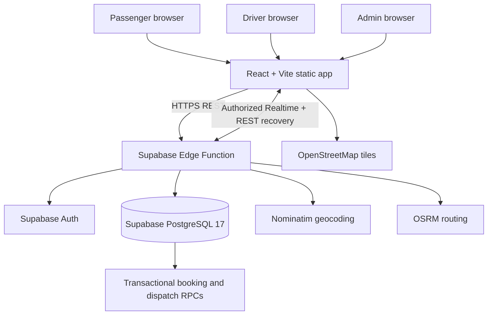

# RideForge architecture

**Assessment date:** 2026-11-14  
**Repository:** `kaustubhdua/Smart_bike_taxi_platform`  
**Assessed base SHA:** `670e946f2b290ec7081d712a073edad6a697f1cb`  
**Purpose:** describe the current academic/portfolio MVP architecture and its verified boundaries. This is not a claim of commercial readiness.

## 1. System boundary

RideForge is a Noida-focused bike-taxi software prototype. The current intended runtime is a React/Vite static frontend on Render, with Supabase Auth, PostgreSQL, Edge Functions and Realtime providing the application backend.

The original C++ API and worker stack remains in the repository as legacy code and historical reference. It is not the active application backend. The three legacy Render API services are not part of the intended runtime and must be removed from the hosting account after the static frontend is confirmed healthy.

RideForge is **not** an authorised commercial aggregator. The current fare is a demonstration tariff, the receipt is not a tax invoice or proof of payment, and no real payment processing, driver-document verification, emergency response or passenger transport is offered.

## 2. Logical architecture

The frontend is served by the retained Render static site. Auth, API requests, durable application state and transactional ride operations are Supabase-hosted. Browser code must never receive the Supabase service-role secret or direct privileged database credentials.

## 3. Components and responsibilities

| Component | Source of truth | Responsibility | Important boundary |
|---|---|---|---|
| Web client | `web/src/App.tsx`, `web/src/components/OperationsWorkspace.tsx` | Passenger planner, booking, tracking, history, driver workspace, admin and support UI | `/` is the API-backed app; `/live` remains an alias. No localStorage ride simulator is part of the intended product |
| Static hosting | Render static site `rideforge-web` | Serves the built React/Vite assets | Keep this service; do not confuse it with the retired legacy API services |
| Authentication | Supabase Auth | Signup, email confirmation, sign-in and JWT issuance | Site URL/redirect allow-list and email delivery must be configured before real signup |
| HTTP API | `supabase/functions/rideforge-api/index.ts` | Authenticated profile, quote, booking, passenger, driver, admin and support operations | Function validates bearer identity and account role before privileged server-side operations |
| Database | Supabase project `ghcufcegfvvjhsnqnrzr` | Accounts, driver profiles, quotes, rides, offers, ride events, support and audit data | PostgreSQL 17; migrations are versioned in the repository and production ledger |
| Booking/dispatch RPCs | `public.rideforge_*` functions | Idempotent booking, availability, one-at-a-time driver offers, acceptance, lifecycle and cancellation | Transactional database functions; privileged execution is not granted to browser roles |
| Realtime | Supabase Realtime publication for `rides` and `ride_events` | Live state updates to authorized participants | RLS and participant checks are security boundaries; clients must recover state through REST after reconnect |
| Geocoding | Nominatim | Converts submitted place labels into coordinates | Public demo endpoint, paced; no production SLA or commercial usage guarantee |
| Routing | OSRM | Returns road distance, duration and geometry | Public demo endpoint; not live traffic or guaranteed availability |
| Map tiles | OpenStreetMap tile service | Displays the route map | External service; map failure must not prevent manual location entry |

## 4. Request and ride lifecycle

1. Passenger submits pickup and destination labels.
2. The Edge Function validates input, obtains geocoding and routing results, and calculates a versioned demonstration fare.
3. The API persists a short-lived quote. The client does not invent a fare when the API is unavailable.
4. Passenger consumes the quote to create a ride. A transactional idempotency key prevents duplicate booking on retries.
5. A database transaction creates the ride and its durable ride event.
6. Dispatch selects one eligible, approved, online driver with a fresh location. One offer is active per ride at a time; offers expire after 45 seconds and dispatch advances across at most five distinct drivers.
7. Acceptance revalidates driver approval, online status and location freshness inside the transaction. Competing acceptances cannot assign the same ride twice.
8. Ride transitions and events are persisted. Supabase Realtime delivers updates to authorized participants; REST remains the recovery path after reconnect.
9. Completion records the final quoted fare and ride history. The printable receipt remains explicitly a demo receipt.

The current implementation does not provide passenger trip-start OTP/PIN confirmation, verified driver identity/licence/vehicle records, emergency dispatch or payment settlement. These are not to be implied by the interface.

## 5. Authentication and trust boundaries

- Supabase Auth owns password handling, email confirmation and access-token issuance.
- An Auth trigger creates the corresponding application account with the Auth user UUID.
- Passenger, driver and admin roles are distinct. Driver accounts require administrator provisioning/approval in the current MVP.
- Edge Function handlers validate the bearer token and application account state/role before privileged operations.
- The Supabase service-role credential is server-only. It must never be placed in Vite variables, browser bundles, source control or client logs.
- All 14 public application tables have RLS enabled. Participant SELECT access is limited to the required account/ride/event data; direct browser writes to application tables are denied. Transactional writes go through the Edge Function and restricted RPCs.
- SECURITY DEFINER functions use a pinned search path and explicit execute grants. Never grant privileged RPC execution to `anon` or general `authenticated` users.
- Quote and external provider requests are rate-limited/throttled. These controls still require abuse/load testing at realistic scale.

## 6. Database, backups and capacity

- Production is PostgreSQL 17 in Supabase region `ap-south-1`.
- Local migration files and the production application migration ledger are reconciled; use reviewed migrations for future schema changes.
- Production currently has no real passenger accounts or rides. Synthetic SQL tests are rolled back and do not constitute real-user journey evidence.
- Supabase Free does not provide automatic daily downloadable backups or PITR. The repository contains an encrypted export workflow, but it is not operational until its repository secrets are configured, a successful export is observed, an off-site copy is stored and an isolated restore drill succeeds.
- No representative load test or production capacity limit has been measured. Do not infer throughput from an empty database or advisor output. Measure query plans, connection behavior, dispatch contention and Realtime reconnect load before increasing traffic.

## 7. External dependencies and failure behavior

| Dependency | Used for | Limitation / required production action |
|---|---|---|
| Supabase Auth | Identity and sessions | Configure redirect URLs, confirmation email delivery, recovery and account security controls |
| Supabase PostgreSQL | Durable state and transactional operations | Verify SSL/network controls, backups, restore, monitoring and realistic performance |
| Supabase Edge Functions | HTTP API and privileged orchestration | Verify exact-head typecheck, live readiness, request logs, timeouts and idempotent retries |
| Supabase Realtime | Ride state updates | Test participant authorization, reconnect/resync and concurrent subscriptions |
| Nominatim | Geocoding | Public endpoint is paced and evaluation-only; obtain a contracted/self-hosted provider for production |
| OSRM | Route metrics | Public endpoint has no traffic or uptime guarantee; obtain a production routing provider for commercial use |
| OpenStreetMap tiles | Map display | Respect tile usage policy or use a contracted tile provider; map failure must degrade gracefully |
| Render static site | Frontend assets | Deploy the merged main SHA and verify browser behavior after deployment |

## 8. Deployment and cutover

The target architecture retains Render only for `rideforge-web` and uses Supabase for the application backend. The repository Blueprint no longer declares a Render API service. Three old Render API service objects still require deletion from the Render dashboard; source configuration changes do not delete already-created cloud resources.

Before calling the academic MVP deployed:
1. Configure Supabase Auth Site URL and allowed redirects for the production frontend and local development.
2. Register and verify a real account; promote the intended owner account through the documented owner-only bootstrap procedure.
3. Merge PR #81 only after all exact-head required CI checks pass.
4. Confirm the Render static site deploys the merged `main` SHA and uses the Supabase Edge Function URL.
5. Run real browser journeys for passenger, driver and admin roles, including two-session authorization and Realtime reconnect.
6. Delete the three legacy Render API services and verify only the static frontend remains for RideForge.

## 9. Explicitly out of scope for the portfolio MVP

- Real payment initiation, signed webhooks, refunds, settlement ledger and tax invoices.
- Driver identity, police, licence, medical, psychological and vehicle-document verification.
- Passenger trip-start OTP/PIN and emergency assistance.
- Strict polygonal operating geofence and legally approved fare schedule.
- Staffed grievance response, safety operations and 24/7 incident handling.
- Commercial aggregator licence, motorcycle authorization, insurance, driver welfare and regulatory certification.
- DPDP operational programme, contractual processor controls and verified data-retention/deletion operations.

These are commercial/legal gates, not tasks that should be faked with demo UI or test credentials.

## 10. Verification sources

- API and transactional behavior: `supabase/functions/rideforge-api/index.ts`, `supabase/migrations/*.sql`.
- Database constraints, RLS and function grants: `docs/SUPABASE_BACKEND.md`, `docs/SECURITY_MODEL.md`.
- Operational commands and release steps: `docs/OPERATIONS_RUNBOOK.md`.
- Current acceptance evidence and unresolved gates: `docs/RELEASE_READINESS_EVIDENCE.md`, `docs/COMPLETION_MATRIX.md`, `docs/DEEP_IMPROVEMENT_RESEARCH.md`.
