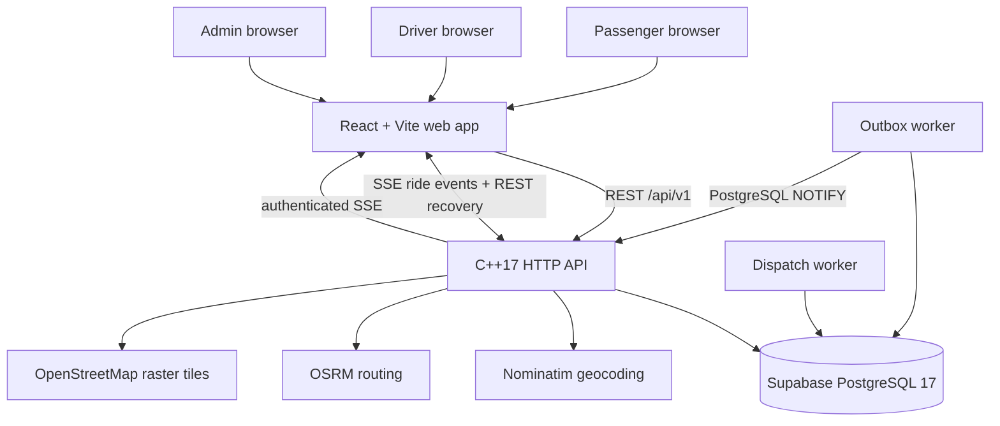

# RideForge architecture

**Assessment date:** 2026-11-14  
**Repository:** `kaustubhdua/Smart_bike_taxi_platform`  
**Assessed main SHA:** `b4f91bc43e5b3185580a84f47238bb9085b2026c`  
**Purpose:** source-of-truth description of the current academic/demo system. This document is not a claim of commercial readiness.

## 1. System boundary

RideForge is a Noida-focused bike-taxi software prototype. It has a passenger booking experience, driver workspace, admin/support workspace, Supabase Auth, PostgreSQL persistence, an Edge Function HTTP API, transactional dispatch RPCs and external geocoding/routing providers. The original C++ API and workers are legacy rollback components during migration.

It is **not** an authorised commercial aggregator. Demo mode, live API mode, simulated receipts and actual financial transactions must remain distinct. A successful local build or database test is not proof of a live ride.

## 2. Logical architecture

The diagram shows the target Supabase-native application path. The React static site remains on Render; authentication, HTTP API, database and transactional ride operations are Supabase-hosted. The old C++ API/worker stack remains in the repository only for rollback until release verification and Render service retirement are complete.

## 3. Components and responsibilities

| Component | Source of truth | Responsibility | Important boundary |
|---|---|---|---|
| Web client | `web/src/App.tsx`, `web/src/components/OperationsWorkspace.tsx` | Passenger booking, driver workspace, admin operations, support UI | API-backed flows require the C++ API; no payment is implied |
| Browser demo | Pending PR #65: `web/src/DemoExperience.tsx` | Local passenger/driver/admin walkthrough | Browser `localStorage` only; no real account, GPS, dispatch, payment or database write |
| HTTP API | `supabase/functions/rideforge-api/index.ts` | Supabase Auth, quotes, bookings, passenger rides, driver actions, admin/support, SSE compatibility | Validates bearer JWT and account role before service-role operations |
| Database | Supabase project `ghcufcegfvvjhsnqnrzr` | Accounts, quotes, rides, offers, events, outbox, support and audit records | PostgreSQL 17; 12 application migrations currently recorded |
| Dispatch RPC | `public.rideforge_dispatch_ride` | Finds eligible approved/online drivers and creates one exclusive 45-second offer | Called after booking and during driver queue refresh; max five distinct drivers |
| Ride events | `public.ride_events` + Supabase Realtime | Persists ride lifecycle changes; SSE compatibility endpoint replays event rows | Realtime publication is participant-scoped by RLS; legacy outbox worker is retained only during cutover |
| Geocoding | Nominatim | Converts location labels into coordinates | Public demo endpoint, paced and cached; no production SLA |
| Routing | OSRM | Returns road distance, duration and geometry | Public demo endpoint, paced and cached; not live traffic |
| Map tiles | OpenStreetMap tile service | Displays route map | External tile service; map failure must not block manual address entry |

## 4. Request and trip lifecycle

1. Passenger submits pickup and destination labels.
2. API validates labels, geocodes both locations, rejects identical resolved coordinates and requests a road route.
3. API calculates the current demonstration fare (₹20 base + ₹11/km, rounded up to paise) and persists a short-lived quote.
4. Passenger consumes the quote to create a ride. Booking idempotency prevents duplicate rides for the same key/fingerprint.
5. A database transaction creates the ride and its durable event/outbox record.
6. Dispatch worker selects one eligible driver at a time. An offer is durable, exclusive and expires after 45 seconds. Decline/expiry advances to the next candidate, subject to the configured maximum attempts. A request that remains unassigned for 10 minutes receives an explicit no-driver outcome.
7. Driver actions move the ride through the permitted lifecycle. Database constraints and transactional updates prevent competing assignment and invalid transitions.
8. Ride events are persisted. The outbox worker publishes notifications; passenger SSE streams replay persisted events and REST remains the recovery path.
9. Completion stores the final quoted fare and history record. A printable receipt is explicitly a demo receipt, not a tax invoice or proof of payment.

The current driver start action validates driver ownership and lifecycle state, but does not implement passenger OTP/PIN confirmation. That is a safety gap before real passenger operations.

## 5. Authentication and trust boundaries

- Supabase Auth owns password hashing, email verification and access-token issuance. The Auth trigger creates the corresponding `public.accounts` row with the same UUID.
- Passenger, driver and admin roles are distinct. Driver profiles are provisioned by an administrator and start unapproved. Approval/suspension is audited.
- Passenger and driver ride queries are scoped to the authenticated account in SQL. UUIDs are not authorization.
- Admin driver approval, support triage and audit endpoints are admin-only.
- Quote-provider rate limiting and distributed abuse controls still need additional hardening before a public production launch.
- Phone/email verification, password reset, account deletion, push/SMS notifications and emergency response are not implemented.
- Driver approval is not identity, licence, insurance or vehicle-document verification.

### Supabase database boundary

The connected Supabase project has RLS enabled on all 12 application tables. Migration 016 adds participant/self SELECT policies for the small set of tables needed by Realtime and explicit deny policies for internal tables; browser roles have no table write grants. Service-role operations are confined to the Edge Function after JWT/account/role validation. The old `rideforge_app` PostgreSQL role is legacy and must not be used by the new Edge API.

Both `public.schema_migrations` and Supabase's migration ledger record versions 001–012. The runtime role's password verifier exists, but authentication from a deployed application process has not been proven.

## 6. Database and capacity

- API PostgreSQL pool: 10 connections per API process, 2-second acquisition timeout.
- Dispatch worker: one persistent database connection.
- Outbox worker: one persistent database connection.
- Approximate one-instance steady-state budget: 12 connections (10 API + 1 dispatch + 1 outbox), plus short-lived migration/maintenance connections. Add 10 per additional API process. This is a budget estimate, not a measured saturation limit.
- Runtime role has no DELETE/TRUNCATE; audit/event/migration records are append-only from the application role.
- Supabase Free plan does not provide automatic daily backups or PITR. No encrypted production backup schedule or production restore drill has been verified.

## 7. External dependencies and failure behavior

| Dependency | Used for | Failure behavior / limitation |
|---|---|---|
| Supabase PostgreSQL | Durable state | API readiness fails when DB/schema is unavailable; no successful deployed runtime connection proven |
| Nominatim | Geocoding | Timeouts, provider errors and non-JSON responses fail closed; public service is evaluation-only |
| OSRM | Route distance/duration/geometry | No live traffic guarantee; provider errors return quote failure |
| OpenStreetMap tiles | Map display | Map may be unavailable independently of quote/booking; manual labels remain the fallback |
| GitHub Actions | CI and release checks | Current PR checks are queued; do not treat queued as passed |
| Hosting provider | Web/API runtime | Vercel is deferred. Static web hosting and persistent C++ API/worker hosting are separate deployment decisions |

## 8. Deployment decision for the next phase

The user has explicitly deferred creating/configuring Vercel until repository engineering is complete. No Vercel project or deployment was created through this execution.

Vercel can host the static React/Vite frontend. It is not a direct runtime for the existing persistent C++ API, dispatch worker and PostgreSQL LISTEN/NOTIFY outbox worker. If Vercel is selected for the frontend, a persistent compute host is still needed for those backend processes. Alternatively, the backend can be deliberately rewritten into serverless/queue-driven components, but that is a separate architecture migration requiring new concurrency, recovery and integration tests.

The existing Render API service is configured with auto-deploy enabled on `main` and the `checksPass` trigger. Therefore, merging any PR to `main` can initiate a Render deployment even though the user has deferred Vercel/hosting work. Do not merge any PR until the hosting decision is confirmed or the user explicitly disables Render auto-deploy. No live Render service setting has been changed. Do not deploy or merge Render-specific changes merely to keep the existing Render service alive. PR #66 is closed with its branch retained as a deferred option; PR #64 contains the CI-only fixes.

## 9. Explicitly out of scope until providers/approvals exist

- Real payment initiation, webhook verification, refunds and settlement accounting.
- Driver identity, licence, vehicle-document and insurance verification.
- Phone/email OTP verification and account recovery.
- Passenger trip-start OTP/PIN confirmation.
- Strict polygonal service-area validation (geocoding context is not a geofence).
- Commercial fare configuration, discounts, taxes and cancellation fees.
- Emergency assistance, staffed safety operations and 24/7 grievance response.
- Automated retention/deletion and production backup/restore operations.
- Commercial aggregator licence, vehicle eligibility, insurance and regulatory certification.

These are tracked as release blockers or provider/legal dependencies, not silently simulated features.

## 10. Verification sources

- Backend endpoint and state behavior: `backend/src/server.cpp`, `backend/openapi.yaml`.
- Database constraints and grants: `backend/migrations/*.sql`, `docs/SECURITY_MODEL.md`.
- Worker behavior: `backend/src/server.cpp`, `backend/tests/concurrency_test.py`, `backend/tests/dispatch_worker_restart_test.py`.
- Operational commands: `docs/OPERATIONS_RUNBOOK.md`.
- Release evidence and known blockers: `docs/RELEASE_READINESS_EVIDENCE.md`.
