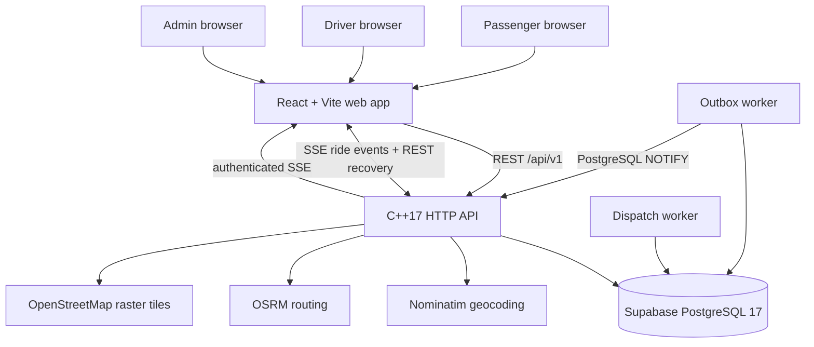

# RideForge architecture

**Assessment date:** 2026-11-14  
**Repository:** `kaustubhdua/Smart_bike_taxi_platform`  
**Assessed main SHA:** `b4f91bc43e5b3185580a84f47238bb9085b2026c`  
**Purpose:** source-of-truth description of the current academic/demo system. This document is not a claim of commercial readiness.

## 1. System boundary

RideForge is a Noida-focused bike-taxi software prototype. It has a passenger booking experience, driver workspace, admin/support workspace, native C++ API, PostgreSQL persistence, durable dispatch/outbox workers and external geocoding/routing providers.

It is **not** an authorised commercial aggregator. Demo mode, live API mode, simulated receipts and actual financial transactions must remain distinct. A successful local build or database test is not proof of a live ride.

## 2. Logical architecture

The diagram shows logical responsibilities, not separate cloud services. In the existing Compose/Render container configuration, the API, dispatch worker and outbox worker are separate processes. They share the same database and fail as a group when one child exits in the Render entrypoint. The user has deferred Vercel deployment; no Vercel project or deployment is part of this assessment.

## 3. Components and responsibilities

| Component | Source of truth | Responsibility | Important boundary |
|---|---|---|---|
| Web client | `web/src/App.tsx`, `web/src/components/OperationsWorkspace.tsx` | Passenger booking, driver workspace, admin operations, support UI | API-backed flows require the C++ API; no payment is implied |
| Browser demo | Pending PR #65: `web/src/DemoExperience.tsx` | Local passenger/driver/admin walkthrough | Browser `localStorage` only; no real account, GPS, dispatch, payment or database write |
| HTTP API | `backend/src/server.cpp` | Auth, quotes, bookings, passenger rides, driver actions, admin/support, SSE | Stateless HTTP process; validates bearer tokens and scopes database queries |
| Database | Supabase project `ghcufcegfvvjhsnqnrzr` | Accounts, quotes, rides, offers, events, outbox, support and audit records | PostgreSQL 17; 12 application migrations currently recorded |
| Dispatch worker | `rideforge_dispatch_worker` | Finds eligible approved/online drivers, creates durable exclusive offers, expires/retries offers | Durable database state; no guarantee of a driver or a live ETA |
| Outbox worker | `rideforge_outbox_worker` | Publishes committed ride events through PostgreSQL NOTIFY, retries and dead-letters failures | Database outbox is source of truth; SSE clients must recover through REST |
| Geocoding | Nominatim | Converts location labels into coordinates | Public demo endpoint, paced and cached; no production SLA |
| Routing | OSRM | Returns road distance, duration and geometry | Public demo endpoint, paced and cached; not live traffic |
| Map tiles | OpenStreetMap tile service | Displays route map | External tile service; map failure must not block manual address entry |

## 4. Request and trip lifecycle

1. Passenger submits pickup and destination labels.
2. API validates labels, geocodes both locations, rejects identical resolved coordinates and requests a road route.
3. API calculates the current demonstration fare (₹20 base + ₹11/km, rounded up to paise) and persists a short-lived quote.
4. Passenger consumes the quote to create a ride. Booking idempotency prevents duplicate rides for the same key/fingerprint.
5. A database transaction creates the ride and its durable event/outbox record.
6. Dispatch worker selects one eligible driver at a time. An offer is durable, exclusive and expires after 45 seconds. Decline/expiry advances to the next candidate, subject to the configured maximum attempts. A request that remains unassigned for 10 minutes receives an explicit no-driver outcome.
7. Driver actions move the ride through the permitted lifecycle. Database constraints and transactional updates prevent competing assignment and invalid transitions.
8. Ride events are persisted. The outbox worker publishes notifications; passenger SSE streams replay persisted events and REST remains the recovery path.
9. Completion stores the final quoted fare and history record. A printable receipt is explicitly a demo receipt, not a tax invoice or proof of payment.

The current driver start action validates driver ownership and lifecycle state, but does not implement passenger OTP/PIN confirmation. That is a safety gap before real passenger operations.

## 5. Authentication and trust boundaries

- New passenger passwords are hashed with PBKDF2-HMAC-SHA-256 (600,000 iterations); access tokens are short-lived HMAC-signed bearer tokens.
- Passenger, driver and admin roles are distinct. Driver profiles are provisioned by an administrator and start unapproved. Approval/suspension is audited.
- Passenger and driver ride queries are scoped to the authenticated account in SQL. UUIDs are not authorization.
- Admin driver approval, support triage and audit endpoints are admin-only.
- Rate limiting is currently process-local, not distributed. Horizontal scaling requires shared limits and aggregate connection budgeting.
- Phone/email verification, password reset, account deletion, push/SMS notifications and emergency response are not implemented.
- Driver approval is not identity, licence, insurance or vehicle-document verification.

### Supabase database boundary

The connected Supabase project has 12 public application tables, all with RLS enabled and intentionally no policies. Browser roles `anon` and `authenticated` have no public-table CRUD grants. The private `rideforge_app` role is a non-superuser LOGIN with BYPASSRLS and explicit backend grants; it has no DELETE/TRUNCATE privileges. The runtime role is trusted only because the C++ API enforces authentication and object-level authorization. Do not add broad browser policies to silence the informational RLS advisor findings.

Both `public.schema_migrations` and Supabase's migration ledger record versions 001–012. The runtime role's password verifier exists, but authentication from a deployed application process has not been proven.

## 6. Database and capacity

- API PostgreSQL pool: 10 connections per API process, 2-second acquisition timeout.
- Dispatch worker: one persistent database connection.
- Outbox worker: one persistent database connection.
- Approximate one-instance steady-state budget: 12 connections (10 API + 1 dispatch + 1 outbox), plus short-lived migration/maintenance connections. Add 10 per additional API process. This is a budget estimate, not a measured saturation limit.
- Runtime role has no DELETE/TRUNCATE; audit/event/migration records are append-only from the application role.
- Supabase Free plan does not provide automatic daily backups or PITR. No encrypted production backup schedule or production restore drill has been verified.

## 7. External dependencies and failure behavior

| Dependency | Used for | Failure behavior / limitation |
|---|---|---|
| Supabase PostgreSQL | Durable state | API readiness fails when DB/schema is unavailable; no successful deployed runtime connection proven |
| Nominatim | Geocoding | Timeouts, provider errors and non-JSON responses fail closed; public service is evaluation-only |
| OSRM | Route distance/duration/geometry | No live traffic guarantee; provider errors return quote failure |
| OpenStreetMap tiles | Map display | Map may be unavailable independently of quote/booking; manual labels remain the fallback |
| GitHub Actions | CI and release checks | Current PR checks are queued; do not treat queued as passed |
| Hosting provider | Web/API runtime | Vercel is deferred. Static web hosting and persistent C++ API/worker hosting are separate deployment decisions |

## 8. Deployment decision for the next phase

The user has explicitly deferred creating/configuring Vercel until repository engineering is complete. No Vercel project or deployment was created through this execution.

Vercel can host the static React/Vite frontend. It is not a direct runtime for the existing persistent C++ API, dispatch worker and PostgreSQL LISTEN/NOTIFY outbox worker. If Vercel is selected for the frontend, a persistent compute host is still needed for those backend processes. Alternatively, the backend can be deliberately rewritten into serverless/queue-driven components, but that is a separate architecture migration requiring new concurrency, recovery and integration tests.

Do not deploy or merge Render-specific changes merely to keep the existing Render service alive. PR #66 is retained as a deferred option; PR #64 contains the CI-only fixes.

## 9. Explicitly out of scope until providers/approvals exist

- Real payment initiation, webhook verification, refunds and settlement accounting.
- Driver identity, licence, vehicle-document and insurance verification.
- Phone/email OTP verification and account recovery.
- Passenger trip-start OTP/PIN confirmation.
- Strict polygonal service-area validation (geocoding context is not a geofence).
- Commercial fare configuration, discounts, taxes and cancellation fees.
- Emergency assistance, staffed safety operations and 24/7 grievance response.
- Automated retention/deletion and production backup/restore operations.
- Commercial aggregator licence, vehicle eligibility, insurance and regulatory certification.

These are tracked as release blockers or provider/legal dependencies, not silently simulated features.

## 10. Verification sources

- Backend endpoint and state behavior: `backend/src/server.cpp`, `backend/openapi.yaml`.
- Database constraints and grants: `backend/migrations/*.sql`, `docs/SECURITY_MODEL.md`.
- Worker behavior: `backend/src/server.cpp`, `backend/tests/concurrency_test.py`, `backend/tests/dispatch_worker_restart_test.py`.
- Operational commands: `docs/OPERATIONS_RUNBOOK.md`.
- Release evidence and known blockers: `docs/RELEASE_READINESS_EVIDENCE.md`.
